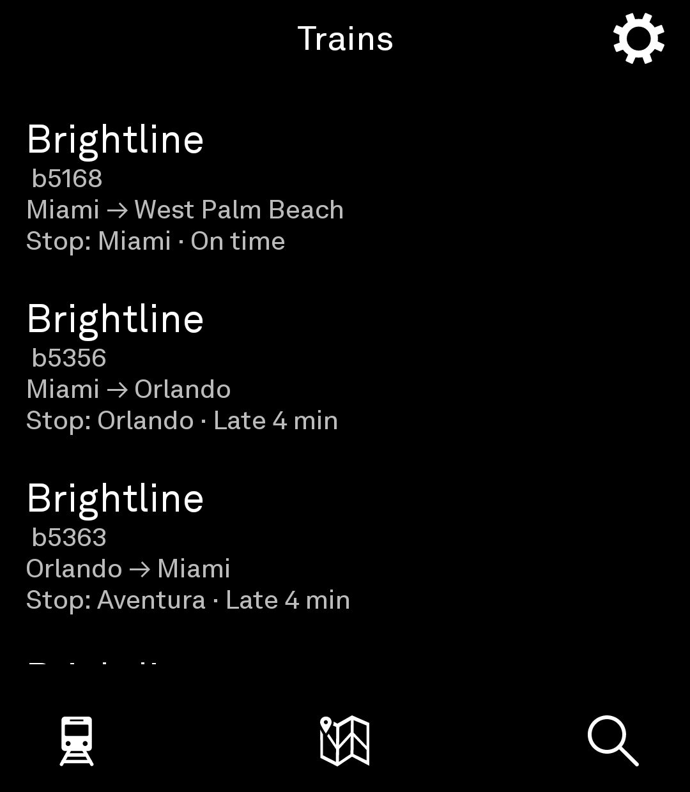
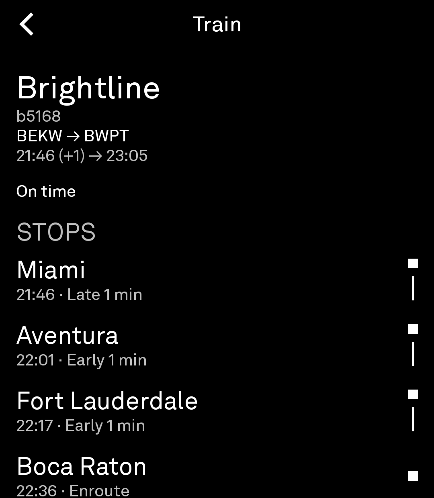
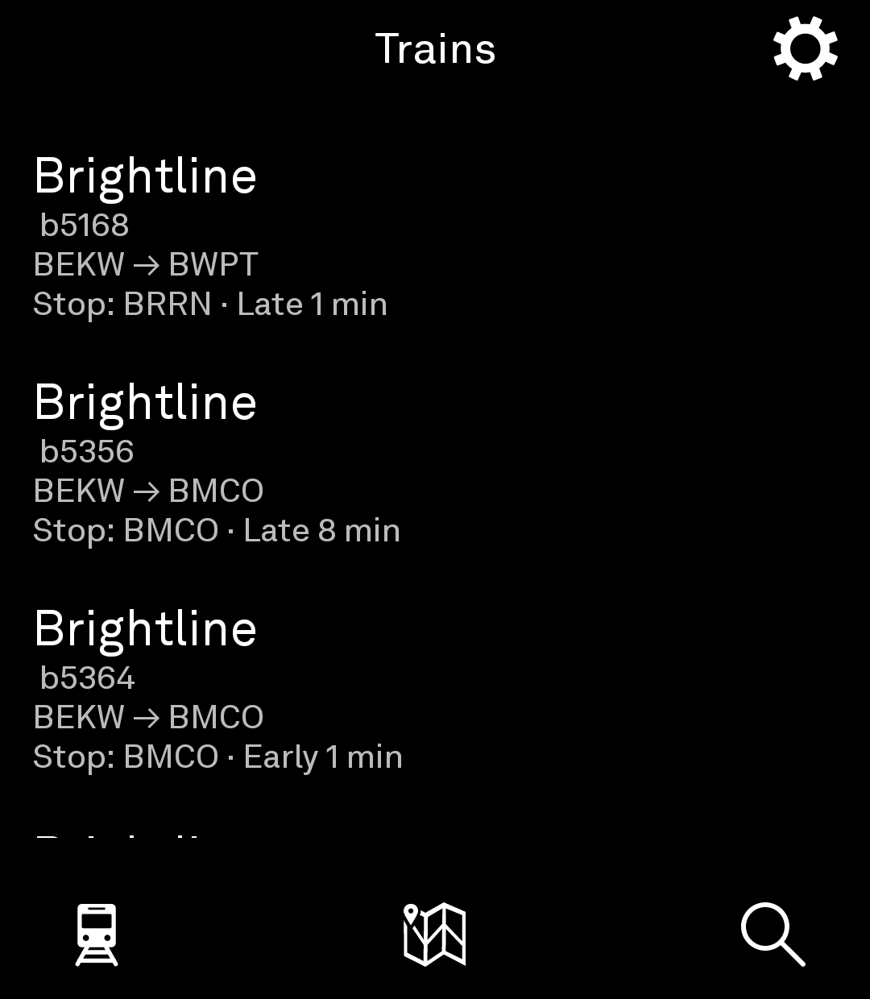

# Amtrak Transit Tool for Light Phone III

A calm, text-first transit app for the Light Phone III built with the Light SDK. Shows real-time train status, stations, and schedules from the Amtraker API.

## Screenshots

## What this app does

- **Trains tab**: Shows all active trains with route, origin/destination, current stop, delay status, heading, and speed
- **Stations tab**: Shows all Amtrak stations; tap to see upcoming arrivals
- **Search tab**: Search by train number, route name, or station name
- **Train detail**: Tap any train to see heading, speed, last updated time, and stop list
- **Station detail**: Tap any station to see upcoming trains with arrival/departure times
- **About**: Tap the gear icon on the home screen top bar to view attribution and data source

## Install

Download the prebuilt APK from the [GitHub Releases](https://github.com/chairmanmortimort/amtrak/releases) page and sideload it with `adb install` or your file manager.

- `Amtrak-1.0.0-release.apk` — minified, `arm64-v8a` only
- `Amtrak-1.0.0-debug.apk` — for testing

## API

Uses the free community API at `https://api.amtraker.com/v1` — no API key required.

## Privacy

The tool makes a single HTTP GET request to `api.amtraker.com` for each train/station list. Request data stays on the device; nothing is stored or tracked.

## License

MIT, the same as upstream light-sdk. See [LICENSE](LICENSE).

The Light Phone, LightOS, and Light Phone III are names of The Light Phone; this project is not affiliated with or endorsed by The Light Phone.
